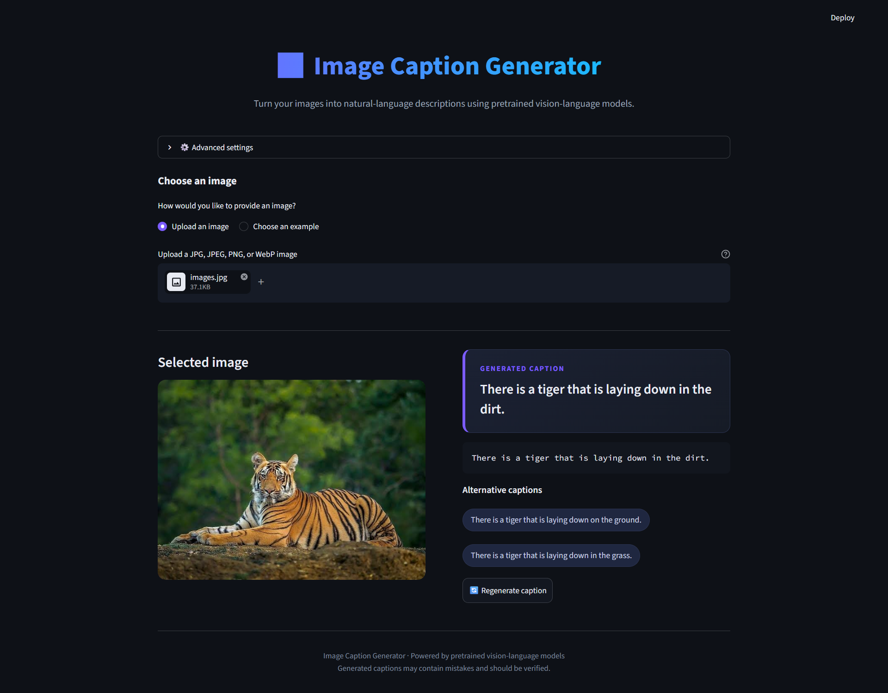
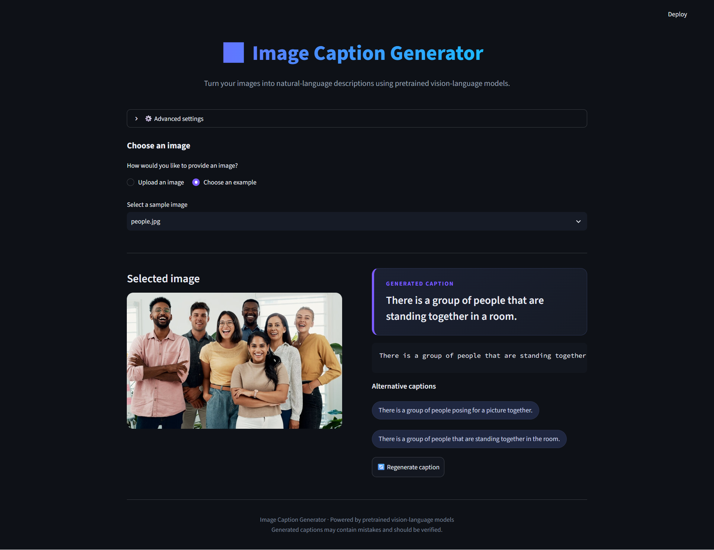
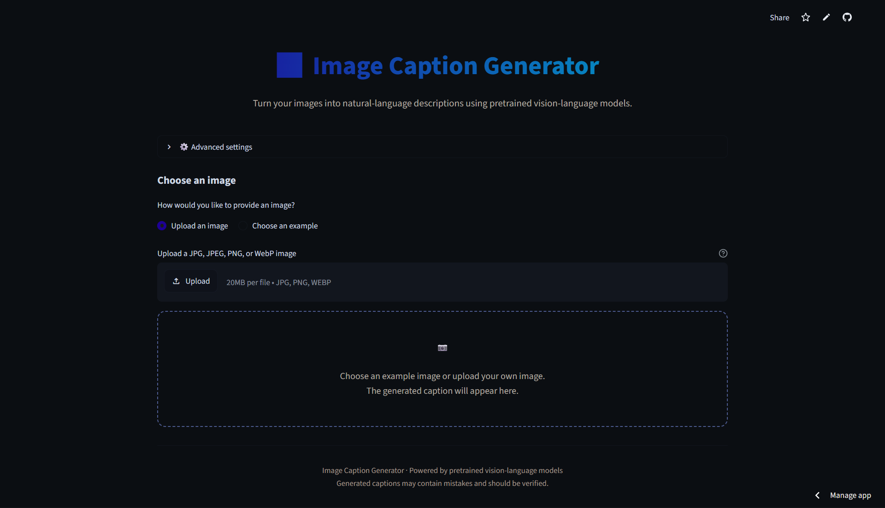

# 🖼️ Image Caption Generator

A deep learning-based web application that generates natural-language descriptions of images using computer vision and vision-language models. Built with Python, PyTorch, and Streamlit, the application allows users to upload images or select sample images and generate captions through an interactive interface.

## 🌐 Live Demo

🚀 **[Try Image Caption Generator](https://image-caption-generator-tgchakgufqrjftvcs8gssm.streamlit.app/)**

## ✨ Features

- **Image Upload:** Upload your own images for caption generation.
- **Example Images:** Select sample images provided by the application.
- **AI-Powered Captioning:** Generate natural-language descriptions of images.
- **Multiple Models:** Support for BLIP and Qwen vision-language models.
- **Alternative Captions:** View alternative captions when available.
- **Caption Regeneration:** Generate another caption for the selected image.
- **Interactive Interface:** Use the application directly through your web browser.
- **CNN + LSTM Baseline:** Includes an optional image-captioning model based on ResNet50 and LSTM.

## 📸 Screenshots

### Uploaded Image

The application generates a caption for an image uploaded by the user.



### Example Image

Users can select an example image and generate its caption.



### Application Interface



## 🖼️ Sample Input Images

### Uploaded Image


### Example Image


## 🛠️ Technologies Used

| Technology | Purpose |
|---|---|
| Python | Core programming language |
| Streamlit | Web application interface |
| PyTorch | Deep learning framework |
| BLIP | Image caption generation |
| Qwen | Vision-language understanding and caption generation |
| Torchvision | Image processing and ResNet50 |
| Pillow (PIL) | Image loading and preprocessing |
| LSTM | Sequence generation in the optional captioning baseline |

## 🧠 Models and Implementation

### 1. BLIP
Implemented in `blip_captioner.py`. BLIP is a pretrained vision-language model used to generate natural-language image captions.

### 2. Qwen
Implemented in `qwen_captioner.py`. The Qwen module supports image understanding and caption generation using a vision-language model.

### 3. CNN + LSTM
The project also includes a CNN + LSTM captioning baseline.

- **ResNet50:** Extracts visual features from images.
- **Embedding Layer:** Represents caption tokens as vectors.
- **LSTM Decoder:** Generates captions sequentially.
- **Vocabulary:** Maps words and tokens used by the decoder.

The baseline uses the saved model artifacts in the `artifacts/` directory when compatible with the implementation.

## 📂 Project Structure

```text
image-caption-generator/
│
├── .streamlit/
│   └── config.toml
│
├── artifacts/
│   ├── README.md
│   ├── caption_model.pt
│   └── vocab.json
│
├── dataset/
│   └── README.md
│
├── examples/
│   └── Example images
│
├── screenshots/
│   ├── streamlit-interface.png
│   ├── uploaded-image-demo.png
│   ├── example-image-demo.png
│   ├── uploaded-image.png
│   └── example-image.png
│
├── app.py
├── blip_captioner.py
├── qwen_captioner.py
├── train.py
├── requirements.txt
├── .gitignore
└── README.md
```

## 🚀 How to Use

1. Open the [live application](https://image-caption-generator-tgchakgufqrjftvcs8gssm.streamlit.app/).
2. Choose **Upload an image** or **Choose an example**.
3. Upload an image or select a sample image.
4. Choose an available captioning model if the application provides that option.
5. Generate the caption.
6. View the generated description and any available alternative captions.

## 👨‍💻 Author

**Abhix47**

- **GitHub:** [Abhix47](https://github.com/Abhix47)
- **Repository:** [Image Caption Generator](https://github.com/Abhix47/image-caption-generator)
- **Live Application:** [Launch on Streamlit](https://image-caption-generator-tgchakgufqrjftvcs8gssm.streamlit.app/)

---

<p align="center">
  Built with Python, Deep Learning, and Streamlit.
</p>